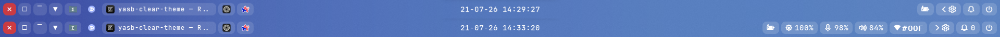
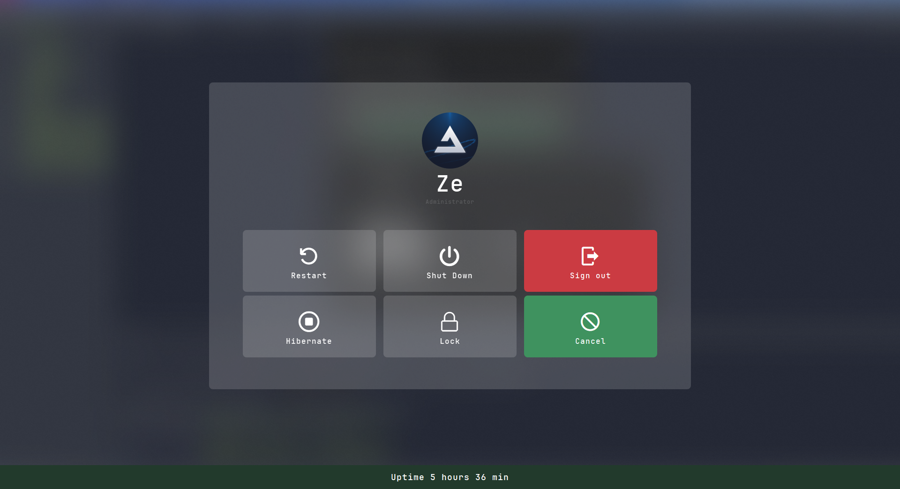
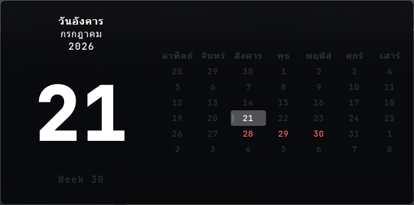
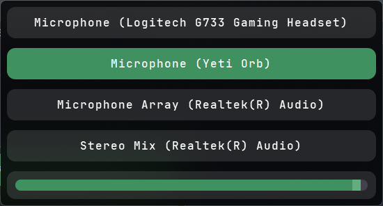
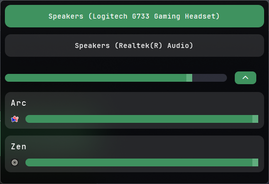
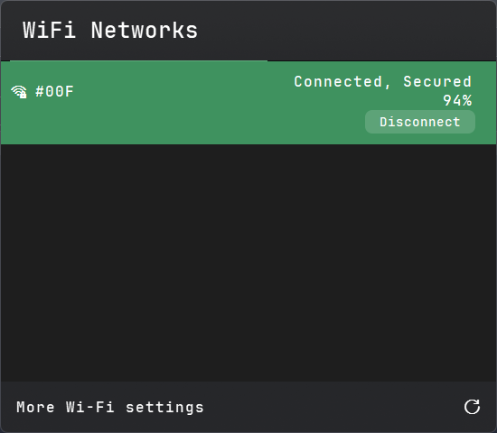
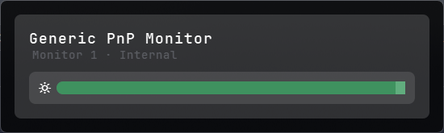

# Yasb bar
## How to install
  1. Download & Install the latest release from [Releases](https://github.com/amnweb/yasb-clear-theme/releases).
  2. Copy `config.yaml` and `styles.css` in `ctn` folder into `%USERPROFILE%/.config/yasb/`.
  3. Enjoy!

## Note
  - Please backup your existing `config.yaml` and `styles.css` before installing this theme.
  - This theme is not available in YASB Theme for now. I will request it to be added soon after all styles are implemented.

## Preview

